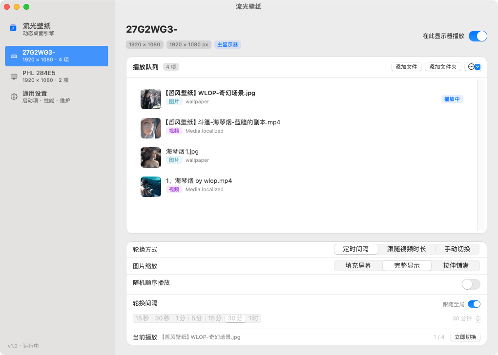
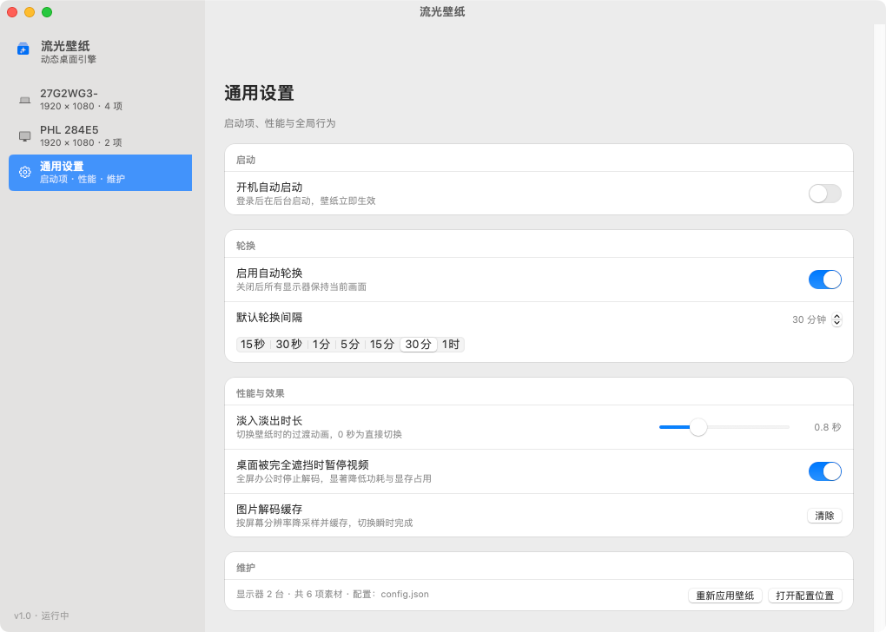
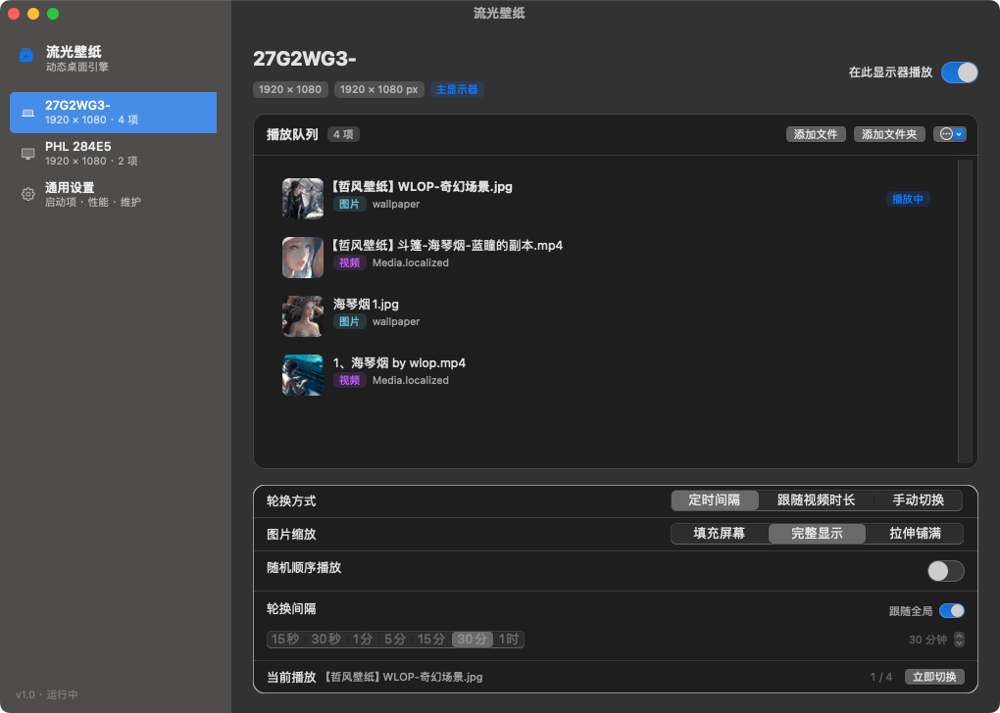

# FlowWall · 流光壁纸

A native macOS live-wallpaper app: point it at your own images and videos, and it plays them as the desktop wallpaper — with an independent playlist per display.

No Electron, no third-party dependencies. Pure Objective-C and AppKit, under 4,000 lines, a single `clang` invocation away from a working `.app`.



## Features

- **Images and videos in one queue.** Mix JPG / PNG / WEBP / HEIC / GIF with MP4 / MOV. Drag files in, drag a whole folder in, or drag to reorder. Double-click any row to play it immediately.
- **Independent playlists per display.** Every screen keeps its own queue, rotation interval, scaling mode, shuffle flag and on/off switch. Displays are identified by their `CGDisplayCreateUUIDFromDisplayID` UUID, so the assignment survives reboots and cable swaps.
- **Rotation modes.** Fixed interval (15 s … 1 h, or a custom value), follow-video-length (switch when the clip ends), or manual only.
- **Cross-fade transitions.** Two buffered layers swap with a configurable fade, so images never flash black.
- **Launch at login.** Backed by `SMAppService` on macOS 13+.
- **Menu bar control.** Pause/resume, switch to the next item, open settings — without a Dock icon.
- **Light and dark.** Follows the system appearance, including the vibrancy sidebar.

| General settings | Dark mode |
| --- | --- |
|  |  |

## Requirements

- macOS 13.0 or later
- Xcode Command Line Tools (`xcode-select --install`) — provides `clang` and the SDK

## Build

```bash
git clone https://github.com/2539421072/FlowWall.git
cd FlowWall
./build.sh release     # or: ./build.sh debug
open "build/流光壁纸.app"
```

The build produces `build/流光壁纸.app`, ad-hoc signed. To install it, copy it to `/Applications`:

```bash
cp -R "build/流光壁纸.app" /Applications/
```

The binary is compiled for the architecture of the machine you build on. For a universal build, add `-arch arm64 -arch x86_64` to the `clang` line in `build.sh`.

## Usage

1. Launch the app. If no playlist exists yet, the settings window opens automatically.
2. Pick a display in the sidebar, then **Add Files** or **Add Folder**.
3. Adjust rotation mode, interval and scaling for that display. Other displays are configured the same way, independently.
4. Close the window — it lives in the menu bar from then on.

The wallpaper sits at the **desktop window level**, above the system wallpaper and below the desktop icons. Desktop icons stay clickable, Mission Control and full-screen apps work normally, and Spaces are unaffected.

## How it works

### Desktop-level window

Each display gets a borderless `NSWindow` at

```objc
CGWindowLevelForKey(kCGDesktopIconWindowLevelKey) - 1
```

with `canJoinAllSpaces | stationary | ignoresCycle`, mouse events ignored. Re-attached to the correct `NSScreen` when displays change, sleep, or wake.

### Rendering

Two `CALayer` slots per display act as a double buffer. A transition renders the incoming item into the off-screen slot, then cross-fades the two layers with a `CABasicAnimation` — no black frame in between.

Video uses `AVQueuePlayer` + `AVPlayerLooper` for gapless looping, muted by default, with `preventsDisplaySleepDuringVideoPlayback = NO` so a wallpaper never keeps the machine awake.

### Performance

The app is designed to sit in the background at near-zero cost:

- **Downsampled decoding.** Images are decoded through `ImageIO` with `kCGImageSourceThumbnailMaxPixelSize` set to the display's pixel size, so a 40 MP photo never lands in VRAM at full resolution. Decoded results are cached in an `NSCache`.
- **Occlusion-aware pausing.** When a display's window is fully covered by other windows for 1.5 s, video decoding pauses; it resumes when the window becomes visible again. Screen lock and display sleep do the same.
- **No timers when idle.** The rotation timer is invalidated whenever it isn't needed.

Measured on a 2×1920×1080 setup:

| Scenario | CPU | Memory |
| --- | --- | --- |
| One looping 1080p video | ~3% | ~88 MB |
| Two looping 1080p videos | ~5.6% | ~90 MB |
| Images, rotating hourly | <1% | ~30 MB |

### Configuration

Everything lives in a single JSON file:

```
~/Library/Application Support/FlowWall/config.json
```

It is written atomically on every change. Editing it by hand works — the app reloads on change.

## Project layout

```
FlowWall/
├── Sources/
│   ├── FWCore.{h,m}         # models, config store, image loader, shared UI bits
│   ├── FWDisplay.{h,m}      # desktop-level window, player slots, per-display controller
│   ├── FWSettings.{h,m}     # settings window (sidebar + per-display pane + general pane)
│   ├── FWLoginItem.{h,m}    # SMAppService wrapper
│   ├── FWAppDelegate.{h,m}  # app lifecycle, menu bar item, main menu
│   └── main.m
├── Resources/
│   ├── Info.plist
│   └── AppIcon.png          # 1024×1024 source icon
├── tools/                   # small test helpers (video/image generators)
├── preview/                 # screenshots used in this README
└── build.sh
```

Debug flags, useful when hacking on it:

| Flag | Effect |
| --- | --- |
| `--settings` | Open the settings window on launch |
| `--diag` | Log window level, window list, system wallpaper per screen |
| `--perf` | Sample CPU / RSS every 5 s |
| `--windowshot <path>` | Capture the settings window to PNG from inside the process |
| `--light` / `--dark` | Force an appearance |
| `--general` | With `--windowshot`, capture the general pane |

## Known limitations

- Ad-hoc signed, not notarized. First launch may need **System Settings → Privacy & Security → Open Anyway**.
- Rotation intervals are per display; there is no global "sync all displays" switch yet.
- HDR video is tone-mapped to SDR.
- Not sandboxed (it needs to read arbitrary files you add to a playlist).

## License

Copyright (C) 2026 The FlowWall Authors.

Licensed under the **GNU General Public License v3.0 only** — see [LICENSE](LICENSE). There is no warranty, to the extent permitted by law.

[中文说明](README.zh-CN.md)
