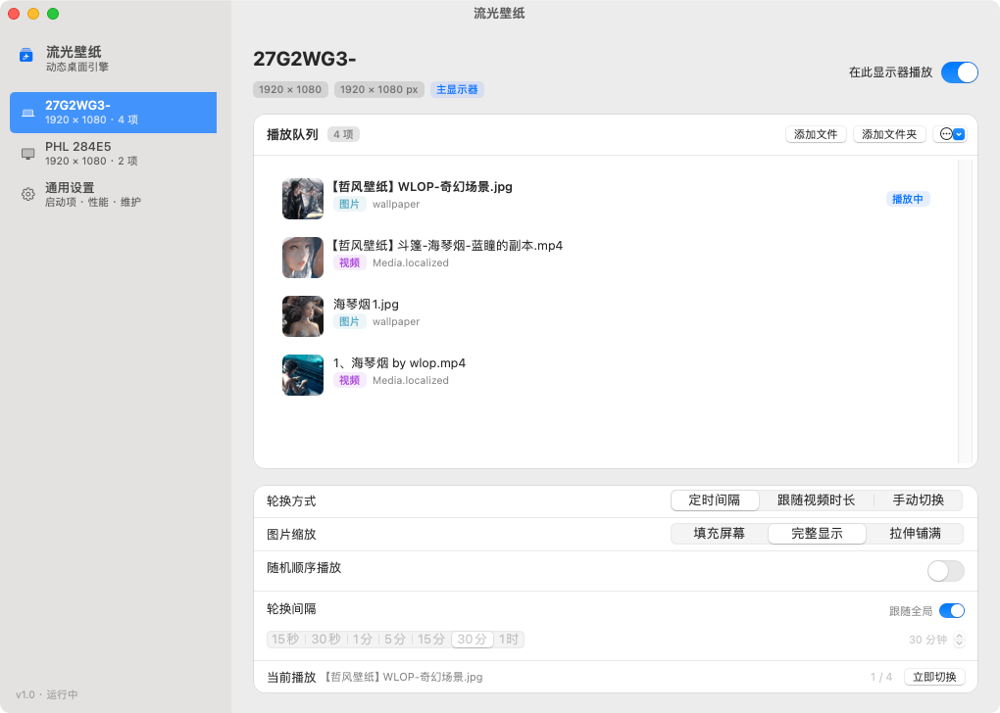
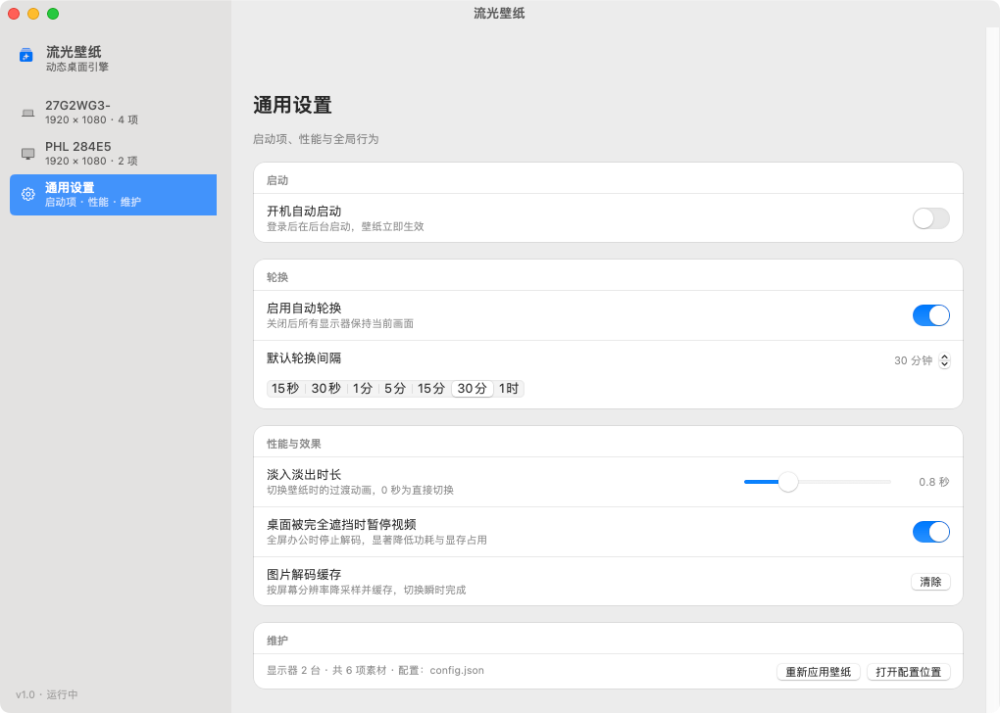
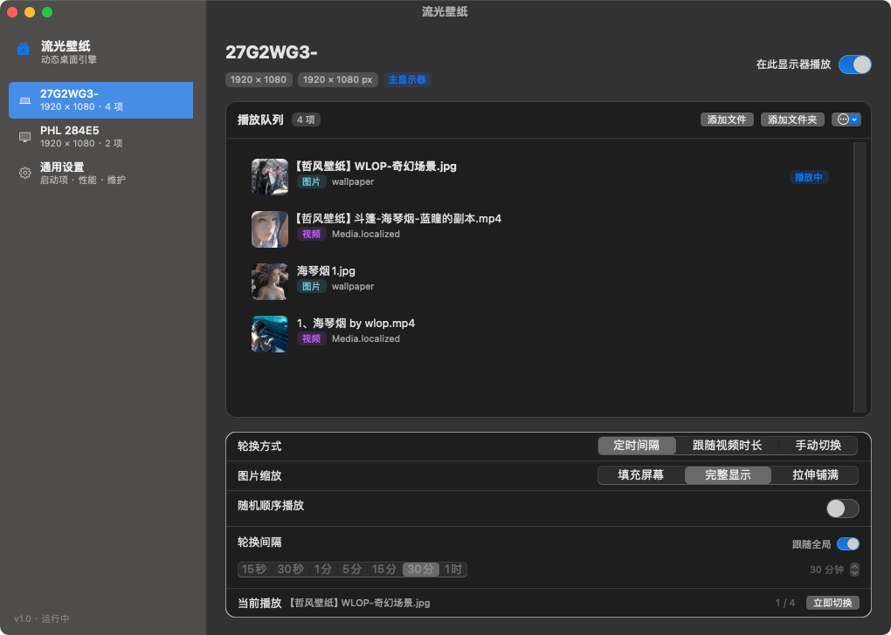

# FlowWall · 流光壁纸

原生 macOS 动态壁纸应用：把自己收藏的图片和视频排成播放队列，当作桌面壁纸循环播放，并且每块显示器可以有各自独立的队列。

没有 Electron，没有第三方依赖。纯 Objective-C + AppKit，一次 `clang` 就能编出可用的 `.app`。



## 下载

已编译好的 Intel 版本：[**v1.0.0 · macOS x86_64**](https://github.com/2539421072/FlowWall/releases/latest)（1.2 MB）。解压后把 `流光壁纸.app` 拖进「应用程序」即可。

这个包是 ad-hoc 签名、未经公证，首次打开请右键 → 打开，或执行：

```bash
xattr -dr com.apple.quarantine "/Applications/流光壁纸.app"
```

在 Apple Silicon 上会走 Rosetta 2 运行；想要原生 arm64 请自行从源码构建。

## 功能

- **图片和视频混排**。支持 JPG / PNG / WEBP / HEIC / GIF 与 MP4 / MOV。可以拖入文件、拖入整个文件夹、拖动排序，双击某一行立即播放。
- **每块显示器独立队列**。每块屏幕都有自己的队列、轮换间隔、缩放方式、随机开关和启用状态。显示器用 `CGDisplayCreateUUIDFromDisplayID` 的 UUID 识别，重启、换线、重新插拔之后配置依然对得上。
- **三种轮换方式**。定时间隔（15 秒到 1 小时，也可自定义）、跟随视频时长（播完再切）、仅手动切换。
- **淡入淡出过渡**。双缓冲图层交替，切换过程不会闪黑。
- **开机自启**。macOS 13+ 由 `SMAppService` 实现。
- **菜单栏控制**。暂停/继续、立即切换、打开设置，且不占 Dock。
- **深浅色自适应**。跟随系统外观，包括侧边栏的毛玻璃。

| 通用设置 | 深色模式 |
| --- | --- |
|  |  |

## 系统要求

- macOS 13.0 或更高
- Xcode Command Line Tools（`xcode-select --install`），提供 `clang` 与 SDK

## 构建

```bash
git clone https://github.com/2539421072/FlowWall.git
cd FlowWall
./build.sh release     # 或 ./build.sh debug
open "build/流光壁纸.app"
```

产物是 `build/流光壁纸.app`，ad-hoc 签名。安装到应用程序文件夹：

```bash
cp -R "build/流光壁纸.app" /Applications/
```

默认编译为当前机器架构。要出通用二进制，在 `build.sh` 的 `clang` 参数里加 `-arch arm64 -arch x86_64`。

## 使用

1. 启动应用。如果还没有任何队列，设置窗口会自动打开。
2. 在左侧选中一块显示器，点「添加文件」或「添加文件夹」。
3. 调整这块屏幕的轮换方式、间隔和缩放。其它显示器同理，各自独立。
4. 关掉窗口即可 —— 之后它只活在菜单栏里。

壁纸窗口位于**桌面层**：在系统壁纸之上、桌面图标之下。桌面图标照常可点，Mission Control、全屏应用、多空间都正常。

## 实现要点

### 桌面层窗口

每块显示器一个无边框 `NSWindow`，层级为

```objc
CGWindowLevelForKey(kCGDesktopIconWindowLevelKey) - 1
```

并设置 `canJoinAllSpaces | stationary | ignoresCycle`，忽略鼠标事件。显示器增减、休眠唤醒时重新挂到对应的 `NSScreen`。

### 渲染

每块屏幕有两个 `CALayer` 槽位作为双缓冲。切换时先把新内容渲染到后台槽位，再用 `CABasicAnimation` 对两个图层做交叉淡入 —— 中间不会出现黑帧。

视频用 `AVQueuePlayer` + `AVPlayerLooper` 实现无缝循环，默认静音，并设置 `preventsDisplaySleepDuringVideoPlayback = NO`，壁纸不会阻止机器休眠。

### 性能

目标是在后台运行时几乎不占资源：

- **降采样解码**。图片通过 `ImageIO` 解码，`kCGImageSourceThumbnailMaxPixelSize` 直接设成屏幕像素尺寸，4000 万像素的原图不会整张进显存。解码结果用 `NSCache` 缓存。
- **遮挡即暂停**。某块屏幕的窗口被其它窗口完全覆盖 1.5 秒后暂停视频解码，重新可见再恢复。锁屏、显示器睡眠同样处理。
- **空闲不留定时器**。不需要轮换时定时器直接失效，不做无意义的唤醒。

双 1920×1080 环境实测：

| 场景 | CPU | 内存 |
| --- | --- | --- |
| 单块屏循环 1080p 视频 | ~3% | ~88 MB |
| 双屏同时循环 1080p 视频 | ~5.6% | ~90 MB |
| 纯图片，每小时轮换 | <1% | ~30 MB |

### 配置文件

所有设置都在一个 JSON 里：

```
~/Library/Application Support/FlowWall/config.json
```

每次改动原子写入。手动编辑也可以，应用会在文件变化后重新加载。

## 目录结构

```
FlowWall/
├── Sources/
│   ├── FWCore.{h,m}         # 数据模型、配置存储、图片加载、公共 UI 组件
│   ├── FWDisplay.{h,m}      # 桌面层窗口、播放槽位、每屏控制器
│   ├── FWSettings.{h,m}     # 设置窗口（侧边栏 + 显示器面板 + 通用面板）
│   ├── FWLoginItem.{h,m}    # SMAppService 封装
│   ├── FWAppDelegate.{h,m}  # 应用生命周期、状态栏、主菜单
│   └── main.m
├── Resources/
│   ├── Info.plist
│   └── AppIcon.png          # 1024×1024 图标源图
├── tools/                   # 调试用的小工具（生成测试视频/图片）
├── preview/                 # README 用截图
└── build.sh
```

调试参数（改代码时很好用）：

| 参数 | 作用 |
| --- | --- |
| `--settings` | 启动时直接打开设置窗口 |
| `--diag` | 打印窗口层级、窗口列表、每块屏的系统壁纸 |
| `--perf` | 每 5 秒采样一次 CPU / 内存 |
| `--windowshot <path>` | 从进程内部把设置窗口截成 PNG |
| `--light` / `--dark` | 强制指定外观 |
| `--general` | 配合 `--windowshot` 截取通用面板 |

## 已知限制

- ad-hoc 签名、未公证。首次启动可能需要在「系统设置 → 隐私与安全性 → 仍要打开」。
- 轮换间隔按屏幕独立配置，暂时没有「所有屏幕同步切换」的开关。
- HDR 视频会做 SDR 色调映射。
- 未开启沙盒（需要读取你添加进队列的任意路径文件）。

## 许可证

版权所有 (C) 2026 The FlowWall Authors。

采用 **GNU 通用公共许可证第 3 版（GPL-3.0-only）** —— 见 [LICENSE](LICENSE)。在法律允许的范围内不提供任何担保。

[English](README.md)
